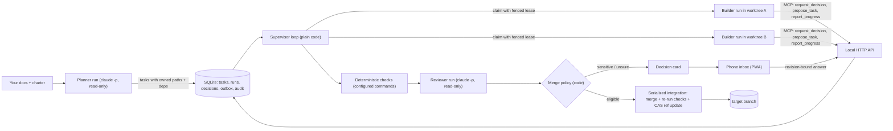

# Architecture

StayOn Autopilot is a small local service. Ordinary code makes every scheduling
and safety decision; Claude Code is called only for bounded jobs (plan, build,
review). State lives in one SQLite file, so a crash or restart loses nothing.



## Components

| Path | Role |
| --- | --- |
| `src/supervisor.ts` | The loop: syncs project configs, heartbeats live work, breaks expired leases, delivers outbox events, dispatches planner/builders/reviewers, runs checks, classifies and integrates merges, turns exceptions into cards. |
| `src/store.ts`, `src/db.ts` | SQLite (Node's built-in `node:sqlite`, WAL). Task state machine, leases with fencing tokens, runs, decisions with revisions and idempotency keys, outbox, audit events, checks, reviews, feedback, inbox sessions. |
| `src/config.ts` | Per-project policy with fail-closed validation (unknown keys are errors). Profiles: `supervised`, `balanced_autopilot`, `integration_only`, `pause`. |
| `src/runner/claude-cli.ts` | Runs `claude -p --output-format stream-json` with the prompt on stdin, `--json-schema` for the result, `--mcp-config` for the autopilot tools, allow/deny tool lists, idle and total timeouts, process-group kill. Strips API-key variables so runs use the subscription. |
| `src/runner/stream.ts` | Parses stream-json, classifies outcomes: success, usage limit (with reset time when stated), auth failure, overload, other failures. |
| `src/runner/fake.ts`, `src/runner/demo.ts` | Scripted agents for tests and the no-Claude demo mode. |
| `src/agent-api.ts`, `src/mcp/server.ts` | Tools agents can call mid-run (`get_task_context`, `request_decision`, `check_decision`, `propose_task`, `report_progress`). The stdio MCP server forwards to the local API with a per-run bearer token; every call is fenced against the run's lease. |
| `src/git/local-forge.ts` | Private bare clone, one worktree per task, squash/merge integration in a dedicated integration worktree, checks on the merged tree, compare-and-swap ref update, idempotent via `Autopilot-Task`/`Autopilot-Head` trailers. |
| `src/git/github-forge.ts` | Same, plus push + PR via `gh`, `gh pr merge --match-head-commit`, PR comments, and polling of conversation comments, reviews and inline review comments. |
| `src/policy/merge-policy.ts` | The merge classifier: `auto_merge`, `human_review`, `repair` or `reject`. |
| `src/checks.ts` | Runs the configured check commands (argument arrays, timeouts, redacted output). |
| `src/http/*`, `src/inbox/*` | JSON API + the phone inbox (vanilla JS PWA; cookie session from a one-time pairing link; CSRF header; strict CSP). |
| `src/push.ts`, `src/notify.ts` | Web Push to the installed PWA (VAPID + aes128gcm with `node:crypto`, verified against the RFC 8291 vector) and optional ntfy. Notifications carry counts only, never card text. |
| `bin/autopilot.ts` | CLI: `init`, `doctor`, `run`, `service` (macOS LaunchAgent), `pair`, `status`, `task`, `decisions`, `answer`, `pause`/`resume`, `logs`. |

## Scheduling rules worth knowing

* Slots are counted from the moment a task is claimed, so asynchronous worktree
  setup can never let more than `maxBuilders` builders (or `maxReviewers`
  reviewers) run.
* Two tasks whose `ownedPaths` overlap never run at the same time; a task that
  owns `**` runs alone. Tasks wait for their `dependsOn` tasks to integrate.
* When a project has `inbox.maxPendingDecisions` or more pending cards, it
  starts a new builder only when none of its builders is running, and its
  planner pauses (you are the bottleneck, so do not create more questions).
* Quota governor: a Claude Code `rate_limit_event` warning limits all projects to
  one builder for 30 minutes; a rejection pauses all model runs until the stated
  reset (or a growing backoff). Checks and merges keep going meanwhile.
* Workers always run with `--strict-mcp-config`, an explicit permission mode
  and `--permission-prompts none`, and by default with `--setting-sources user`
  (builders follow `execution.settingSources`; the planner and reviewer always
  use `user`), so unless you allow project settings a branch cannot inject
  hooks, environment variables or an `apiKeyHelper` into unattended runs.

## Task lifecycle

```
proposed → ready → building → checking → review_ready → reviewing → merge_ready → merging → integrated
                       │          │                         │             │            │
                       └──────────┴────── repair (back to ready, budgeted) ┴────────────┘
             building / reviewing / merging ──► waiting_decision ──(answer)──► ready | merge_ready | checking
             budget spent ──► exhausted ──(diagnostic card: retry)──► ready
             any open task ──(cancel: inbox or `autopilot task cancel`)──► cancelled
```

* **Leases and fencing.** Claiming a task bumps its `lease_generation`. A run's
  tool calls and its final result are accepted only while it still owns that
  generation. Live processes are heartbeated; leases left by a crashed process
  expire or are broken on restart, and the old worker is fenced out.
* **Budgets.** `maxAttempts` counts builder runs that failed for task reasons;
  `maxRepairCycles` counts failed checks, change requests and merge conflicts.
  Usage limits, auth failures, pauses and lost resumes do not consume attempts.
* **Resume.** A task keeps its worktree and its last Claude session id. After a
  decision, review or repair, the next builder run resumes that session with the
  new information; if the session cannot be resumed, a fresh run gets the task's
  durable notes instead.

## Decisions (cards)

* Kinds: `choice` (product intent), `review` (judge a concrete revision),
  `authorization` (one exact operation on one exact artifact), `diagnostic`
  (work cannot progress), `info`.
* An answer is saved in one transaction with an outbox event; delivery is
  retried until processed, so a lost notification never loses an answer.
* Every answer carries the card's `revision` and an idempotency key. Revised
  cards reject old answers; retries return the stored result.
* Review cards are bound to the exact commit (`artifactRef`). If the branch
  moves after the card was shown, an approval re-verifies instead of merging.
* Duplicate questions merge on a `dedupeKey` and block every waiting task.
* Blocking cards stop only their task; everything else keeps running. With
  `inbox.maxPendingDecisions` or more pending cards in a project, it starts new
  builders only one at a time.
* No answer means pending, never permission.

The data model, the agent tools and the inbox API are specified in
[card-protocol.md](card-protocol.md).

## Merge policy

Order of checks in `classifyMerge`:

1. Protected paths changed (default `.autopilot/**`, `.claude/settings.json`, `.claude/settings.local.json`) → **reject** (builder must revert).
2. Any configured check missing or not passed on this exact head → **repair** (missing evidence is not success).
3. No independent review of this exact head, reviewer asked for a human, or an approval that still lists blocker/major findings → **human review**; change requests → **repair**.
4. Pending blocking cards or open change requests → **human review**.
5. Auto-merge only if the profile allows it and: no sensitive paths, inside `allowedPaths` when set, under `maxAutoMergeLines`, not high risk, not an integration task, not a mass deletion.

Your approval of the exact head (card or GitHub review by a trusted actor)
overrides step 5 only. Integration then merges in a separate worktree, re-runs
the checks on the merged tree, and moves the target branch with a
compare-and-swap; a conflict or a red integrated build sends the task back for
repair and never moves the branch.

## Security boundaries

**Threat model, stated plainly.** Builders run as your OS user. The
autopilot is designed against confused or careless agents and against
prompt-injected attempts that use git, `gh` or file tools — not against a
determined attacker running with your user's privileges, who could, for
example, edit the database directly. Closing that gap needs OS-level
isolation (running workers as a separate OS user or in a VM), which is not
done yet. Note that your check commands run code the builders wrote, as your
user, before any review.

Within that model:

* **Target branch integrity.** Worktrees share refs with the private clone, so
  a builder could move the target branch with `git update-ref`, `branch -f` or a
  local fetch or push. The supervisor records the head it set, exactly as it
  checked it (a new merge commit must sit directly on the recorded head; a
  merge that found nothing to do records nothing), checks it every tick and
  before every merge, and on any mismatch restores it, pauses the project and
  raises an urgent card (drill: "a builder that moves the target branch"),
  however much the new head looks like one of its own merges. Only two
  unrecorded moves are kept. One is the repository sync's fast-forward to
  the source repository's branch, and only to the head that the source itself
  reports right after a fetch that brought that commit. The supervisor asks
  the configured source with `git ls-remote` run outside any repository, so
  neither `refs/remotes/origin/*` nor the clone's config (origin's URL, which
  must be exactly the configured source, or an `insteadOf` rule) counts, since
  workers can write those too; offline nothing moves. The query gets origin's
  URL on its command line, so `includeIf "hasconfig:remote.*.url:..."` rules
  in your git config apply to it as they do to the fetch, but `gitdir:` and
  `onbranch:` rules do not: settings needed to reach the source must not
  depend on them. The database keeps the confirmed head from just before the
  sync moves `main` to it until the supervisor has checked that move, or the
  move failed, so a crash in between is not taken for tampering, even by a
  restart that cannot reach the source (should the database fail to note that
  a move failed, only the running supervisor remembers it: a restart before
  the next check would trust that head again). The other is a merge that a
  crash cut off before it was recorded: on the project's first check after a
  restart (the database remembers the interrupted merge until then, should
  that restart die too), before any worker of the project runs, the supervisor
  keeps an unrecorded head only if it is exactly the integration commit that
  the interrupted merge stored just before it moved the target, once its
  integration checks had passed. A copy that a worker made of that merge while
  it ran is caught like any other move.
  Integrated work is pushed to `repo.pushIntegratedTo` only after these
  checks, and only the checked head, so a target branch that a worker moved
  never reaches your repository. These checks trust the source as your git
  setup reaches it: workers run as your user, so without OS-level isolation a
  worker can still write a local source repository itself, or add an
  `insteadOf` rule to your global git config, which the supervisor's own git
  reads too. The sync then takes the head the worker planted for the source's
  own and pushes it to `repo.pushIntegratedTo`. Likewise, merges are built in
  an integration worktree inside the private clone: a worker process that
  rewrites that worktree's `HEAD` or index while a merge runs can make the
  supervisor move the target to, record and push a commit other than the
  merge it checked.
* **Policy changes need you.** A `config.json` that changes while the
  autopilot runs (or differs from the last approved one at restart) produces an
  authorization card; until you approve, the previous policy stays in force.
  New project configs that appear while running also need approval.
  `autopilot run --accept-config` skips this when you edited the files yourself.
* **No repository hooks in supervisor git commands.** Every git command the
  supervisor runs uses `core.hooksPath=/dev/null`, `core.fsmonitor=false`,
  `core.untrackedCache=false` and `protocol.ext.allow=never`, and ignores
  replace refs and grafts (`core.useReplaceRefs=false`,
  `GIT_NO_REPLACE_OBJECTS=1` and `GIT_GRAFT_FILE=/dev/null/no-grafts`, a file
  that cannot exist), so a worker that writes `refs/replace/*` or `info/grafts`
  cannot make the supervisor diff, scan or review other objects or history than
  the ones it merges and pushes. Every worker run gets the two variables as
  well, and `core.useReplaceRefs=false` in `GIT_CONFIG_PARAMETERS` (after any
  settings already there, as `git -c` passes them on), so a reviewer's own
  `git diff` and `git log` show the same commits. The git commands the
  supervisor runs inside builder worktrees, and all check commands, also run
  with Claude/GitHub/cloud credentials removed from the environment; fetches,
  pushes and merges in the private clone keep your environment because they may
  need your git credentials.
* **Secrets.** Leftover files are auto-committed only if they do not look like
  secrets (`.env*`, keys, credentials); the changes and the full message of
  every commit on a branch (merge and root commits included) are scanned for
  secret-looking values before it is published and again before it merges, so
  a secret added and removed again in a later commit is still caught. A merge
  commit's changes are the lines that none of its parents has. A branch whose
  history cannot be scanned completely (more than 32 MiB of changes or of
  commit messages, or a git error) is treated like one with a secret: it is
  neither published nor merged. Files that git treats as binary (such as
  images, archives or SQLite databases) are not scanned. The scan catches
  accidental leaks, not a secret hidden on purpose: workers can write the
  private clone's config and `info/attributes`, so a worker can make git treat
  any file as binary, and a commit message can hide text from `git log` (after
  a NUL byte, or behind its own `encoding` header). These are known
  limitations.
* **Approvals are bound to commits.** Inbox approvals, GitHub approvals and
  `/approve CODE` comments all apply to one exact revision; your "request
  changes" is recorded so that revision can never merge later.
* Policy, state and credentials live in `~/.stayon-autopilot`, outside every
  worktree. Builders cannot edit the config through their branch; changes to
  protected paths are rejected at merge time, and tool rules deny reading the
  database, token, configs and run logs.
* Builders are denied the tools to push or merge (`git push`, `gh pr merge`,
  `gh pr review`), and only the supervisor integrates. Reviewers and the planner
  run with `dontAsk` permission mode and no edit tools: read tools, `git status`,
  `git ls-files` and `ls`, plus WebSearch/WebFetch for the planner. A reviewer
  may also run, exactly as its prompt lists them, the `git diff`/`git log`
  commands for the revision under review and those of your check commands whose
  arguments are all plain words (letters, digits and `_@%+=:,./-`). Beyond
  `git status`, `git ls-files` and `ls`, neither role gets a prefix rule:
  `git diff:*` or `npm test:*` would let it add options that write files
  (`--output=<file>`, `eslint -o`).
* Workers run with API-key variables removed, so they always use the Claude
  subscription; there is no silent paid-API fallback.
* The agent bridge (`/agent/tools/*`) accepts only loopback connections with a
  per-run bearer token. The inbox needs a session cookie from a single-use
  pairing link, a CSRF header for every write, and a strict CSP; agent text is
  rendered with `textContent` only.
* Untrusted text (issues, comments, docs, web pages) is data: prompts say so,
  GitHub feedback is accepted only from `feedback.trustedActors`, and nothing an
  agent writes can change policy or approve its own work.

## Failure drills

`test/drills/drills.test.ts` runs the real supervisor, git forge and check
runner against temporary repositories:

| Drill | Expected behaviour |
| --- | --- |
| Two builders in parallel | Both run concurrently; both auto-merge; no cards. |
| Blocking decision | Task yields; other work merges meanwhile; the answer resumes the same Claude session. |
| Answer while the supervisor is down | Saved + outbox; delivered after restart; duplicate answer is idempotent. |
| Crashed worker returns | Restart breaks its lease; its later tool calls get 401/409 and its result is fenced out. |
| Expired lease while running | Lease broken, generation bumped, task rebuilt. |
| Two branches edit the same file | Second merge conflicts; builder merges the target and resolves; then merges. |
| Green branch, red integration | Target branch never moves; repair; then merges. |
| Usage limit | Account-wide pause; no attempt consumed; resumes after the window. |
| Protected policy edit | Rejected; builder reverts; then merges without the policy change. |
| Sensitive change | Review card bound to the commit; a stale approval does not merge a newer commit. |
| Reviewer requests changes | Findings go back to the builder; second review approves. |
| Auth failure | Everything pauses; one card; resume continues. |
| Repeated failures | Budget exhausted; one diagnostic card; "retry" continues. |
| Check step keeps crashing | Three bounded retries, then one card; "retry" re-runs only the checks, not the builder. |
| Planner dependencies | Foundation task runs alone first; dependents follow. |
| Plan application (`planner.test.ts`) | Duplicate titles skipped, `maxTasksPerPlan` enforced, dependency cycles broken, proposals accepted, obsolete tasks cancelled, questions are non-blocking, an answer invites a new plan. |
| GitHub feedback (`github-feedback.test.ts`) | Trusted change request repairs once even if redelivered; untrusted comments ignored; a trusted GitHub approval of the exact head merges and supersedes the card; feedback after merge becomes a follow-up task; `/approve` needs the card's one-time code. |
| Target branch tampering | A builder that moves `main` is caught; `main` restored; project paused with an urgent card; the work later merges only through the gate. A forged copy of the supervisor's own merge commit is caught the same way. |
| Crash between merging and recording | After the restart, the interrupted merge is kept (not merged twice) and the queue continues; any other unrecorded commit on `main` is tampering. |
| Target integrity (`target-integrity.test.ts`) | A forged `origin/main` behind a ref lock never moves `main`; `main` moved along with it, or to a head the source cannot vouch for at the sync (origin redirected before the fetch, `origin/main` rewritten or the source unreachable after it), is caught at the sync and restored; origin redirected between the config audit and the fetch (its URL rewritten, an `insteadOf` rule in the clone's config, or a relative URL that names the source only from the supervisor's directory) never moves `main`, on GitHub either, and none of it reaches your repository; a head moved in before a sync or under a merge is caught before anything is pushed to your repository; a head moved between a check and its record is never recorded, and an "already integrated" or "no changes" merge on a moved `main` is tampering, on GitHub too; a merge is recorded before anything else can fail, so a failure right after it raises no card; after a GitHub merge, or one GitHub refused after its sync moved `main`, only the head the source confirms is recorded, also when the sync after the merge cannot move `main`; a real upstream push is fast-forwarded with no card; a head a sync confirmed counts only until its move was checked or failed: a sync a crash cut off right after its fast-forward is kept by a restart that cannot reach the source, also when git lost the exit status of a fast-forward that moved `main`, a head that cannot be stored never moves `main`, and a head whose fast-forward failed is never taken later, even after the source dropped it, by a restart, through the confirmation of that same sync, while a worker moves `main` around the failure or when `main` cannot be read after it, or, until the supervisor restarts, when the database could not note the failure; offline, work continues and the push catches up later; a merge a crash cut off is still kept when the restart after it dies, or stays paused, before its first check, and only until that check, while a copy of the merge in flight that a worker put on `main` is not kept when the supervisor dies, and a later merge job never runs with the record of an attempt that died before moving `main`. |
| Quota governor | After a usage warning, later builders start only when no other builder runs. |
| Regressions (`regressions.test.ts`) | Policy edits need approval and update the runtime in place; a rejected revision never merges; cancelling one task keeps a shared card for the others; no cancel during a merge; secrets never published or merged, even when a later commit removed them, they follow more than 2 MB of other changes or a branch reaches a `.env` file only by renaming another file, and a history too large to scan fails closed; a replace ref cannot hide a change from the merge gate; reviewers and the planner get no git command that can write files; an answer arriving before the run ends resumes without a second card; a builder that switches branches keeps its work; after merging `main` into its branch, a task is judged only on its own changes. |
